# Lesson 1 Notes: Linux, Vim, Shell and Git

笔记源于第一课学长讲的时候记的笔记，这部分比较少的就转为文字写到笔记里了，C++ 的笔记有点乱，所以打算用图片形式补充。

> 作者：Aurora3137  
> 日期：2026-10-21

## 1. Linux

**核心理解**：Linux 把大部分资源都当成"文件"，命令围绕文件、目录和权限展开。命令行比图形界面更精确、更适合自动化。

| 命令 | 作用 | 示例 |
| --- | --- | --- |
| `pwd` | 显示当前所在目录 | `pwd` |
| `ls` | 列出目录内容 | `ls -la` |
| `cd` | 切换目录 | `cd ~/missing-semester` |
| `mkdir -p` | 递归创建目录 | `mkdir -p a/b/c` |
| `cat` | 打印文件内容 | `cat output.txt` |
| `rm` | 删除文件 | `rm temp.txt` |
| `chmod +x` | 给脚本添加可执行权限 | `chmod +x homework1.sh` |
| `man` | 查看命令手册 | `man wc` |

**练习记录**：`ls -la` 会显示 `drwxr-xr-x` 这样的权限串，第一位的 `d` 表示目录；输出里的 `.` 是当前目录、`..` 是上级目录。我第一次把它们误认为是文件，后来才明白那是"目录是空的"的意思。

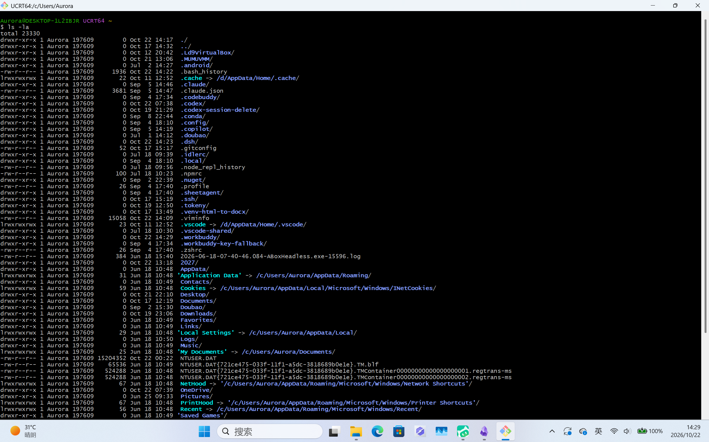

## 2. Vim

Vim 的核心是"模式"：普通模式执行命令，插入模式输入文字，命令模式用于保存、退出和搜索。

| 按键/命令 | 含义 |
| --- | --- |
| `i` | 进入插入模式（底部出现 `-- INSERT --`） |
| `Esc` | 回到普通模式 |
| `:wq` | 保存并退出 |
| `:q!` | 不保存强制退出 |
| `dd` / `yy` / `p` | 删除当前行 / 复制当前行 / 粘贴 |
| `u` | 撤销 |
| `/keyword` | 搜索关键词 |

**练习记录**：我练习过 `vimtutor zh`。实际写作业时最容易错的两点：① 忘记先按 `i` 就粘贴，内容不会出现；② 中文输入法下 `:` 会变成全角 `：`，`:wq` 不生效。另外在 Git Bash 里粘贴要用 Shift+Insert，Ctrl+V 无效。

## 3. Shell

Shell 是用户和内核之间的命令解释器：读取命令、解析参数、启动程序，并处理输入输出重定向。

- `|` 管道：把前一个程序的输出变成后一个程序的输入
- `>` 重定向输出，覆盖写入文件
- `>>` 追加输出到文件末尾
- `<` 重定向输入
- `$(命令)` 命令替换：把命令的输出嵌入到另一个命令中
- `bash -n 脚本` 只做语法检查，不执行脚本

**练习记录**：`history | tail -n 10` 查看最近 10 条命令；`wc -w 文件` 统计单词数、`wc -m` 统计字符数。作业脚本里用 `{ ... } > output.txt` 把一整组命令的输出重定向进同一个文件。

## 4. Git and GitHub

Git 是分布式版本控制系统，用快照（commit）记录每次修改；GitHub 是托管 Git 仓库、进行协作开发的平台。

| 命令 | 含义 |
| --- | --- |
| `git status` | 查看工作区状态 |
| `git add` | 暂存修改 |
| `git commit -m "..."` | 提交，形成一次快照 |
| `git log` | 查看提交历史 |
| `git push` | 推送到远程仓库 |
| `git clone` | 克隆远程仓库到本机 |
| `git branch` / `git switch` | 查看 / 切换分支 |

**协作流程**：Fork 课程仓库到自己账号 → clone 到本机 → 新建个人分支 → 修改文件 → commit → push → 向课程仓库发起 Pull Request（base 选课程仓库的 `master`，head 选自己的分支）→ 根据 review 评论在原分支继续提交，PR 会自动更新。

**练习记录**：这次作业完整走了一遍 fork / clone / branch / push 的流程。遇到的问题是相对路径依赖当前目录——新开 Git Bash 窗口默认在家目录，必须先 `cd ~/missing-semester` 再操作，否则 Vim 会报 `[New DIRECTORY]`。

## 5. C++ 补充笔记

课堂上还补充了一些 C++ 的内容，这部分以课堂记录截图的形式整理如下。

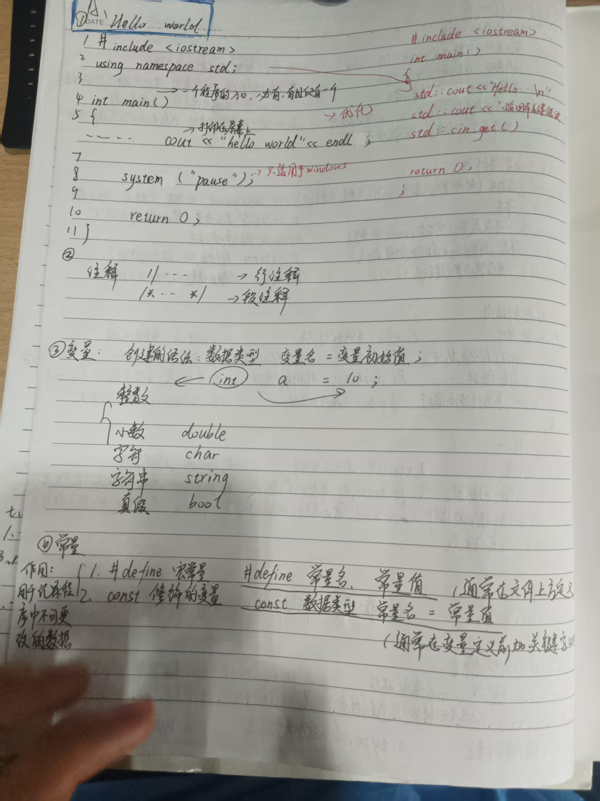

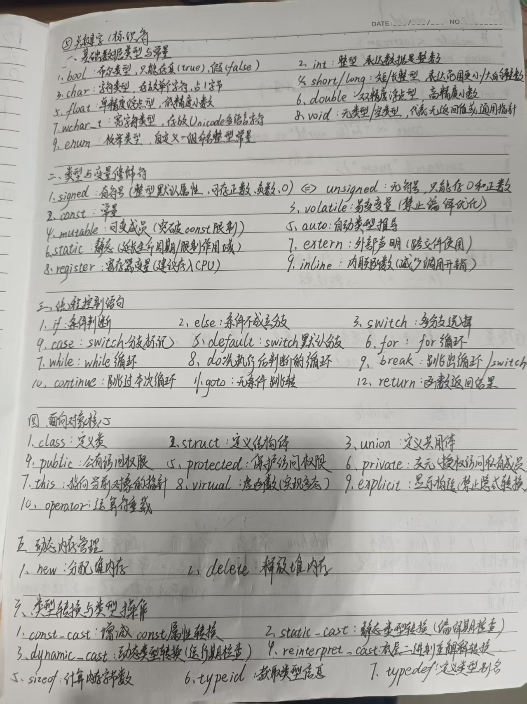

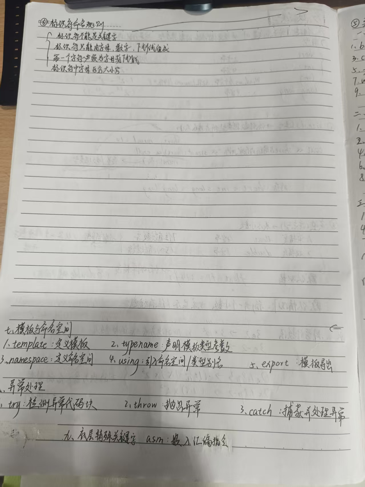

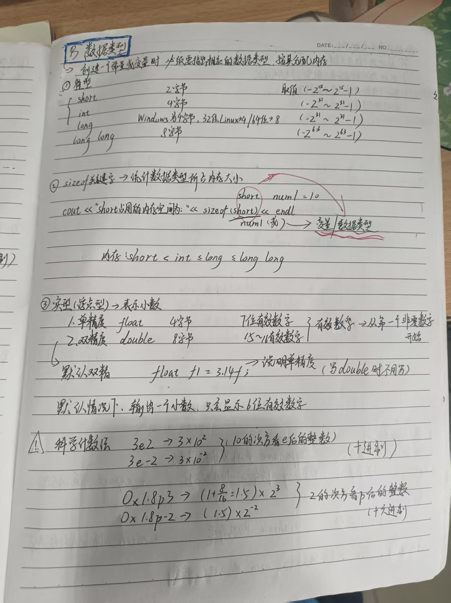

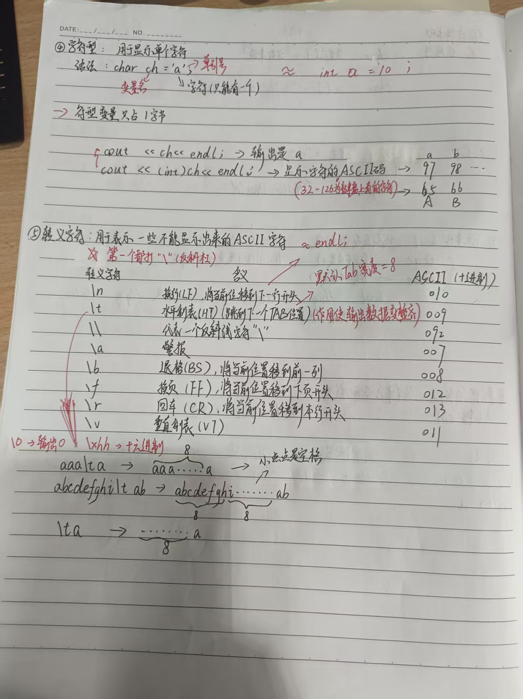

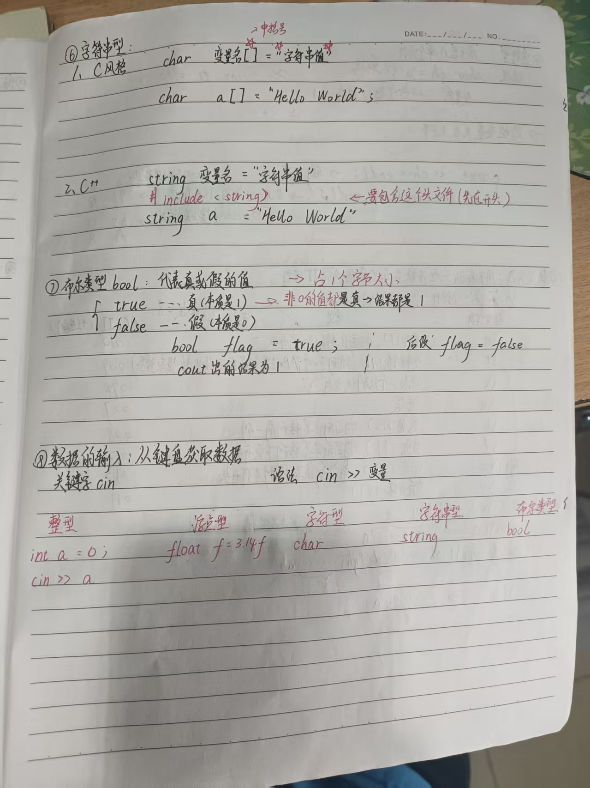

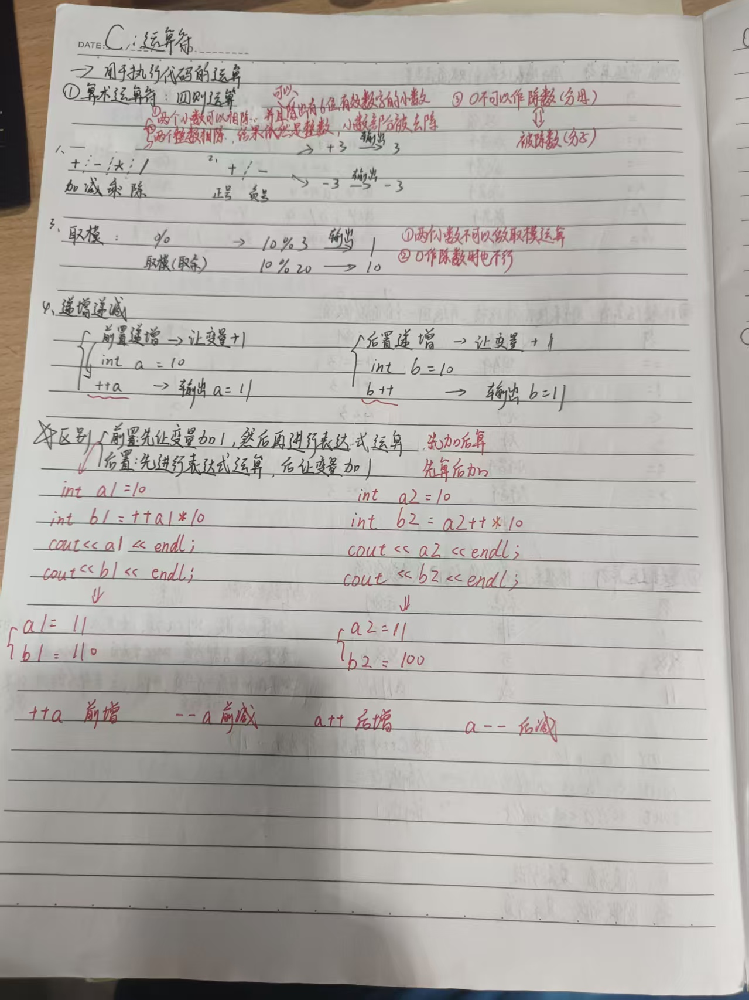

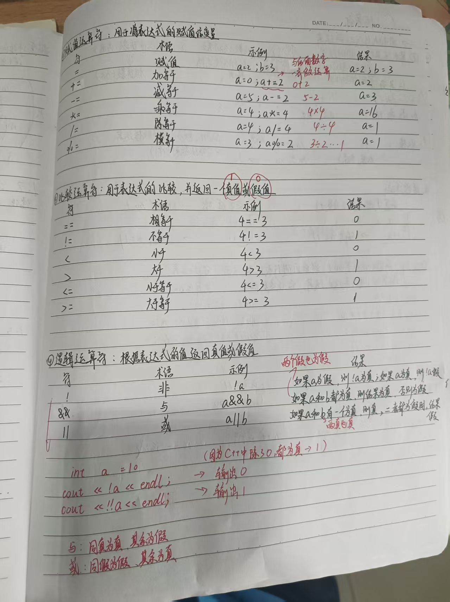

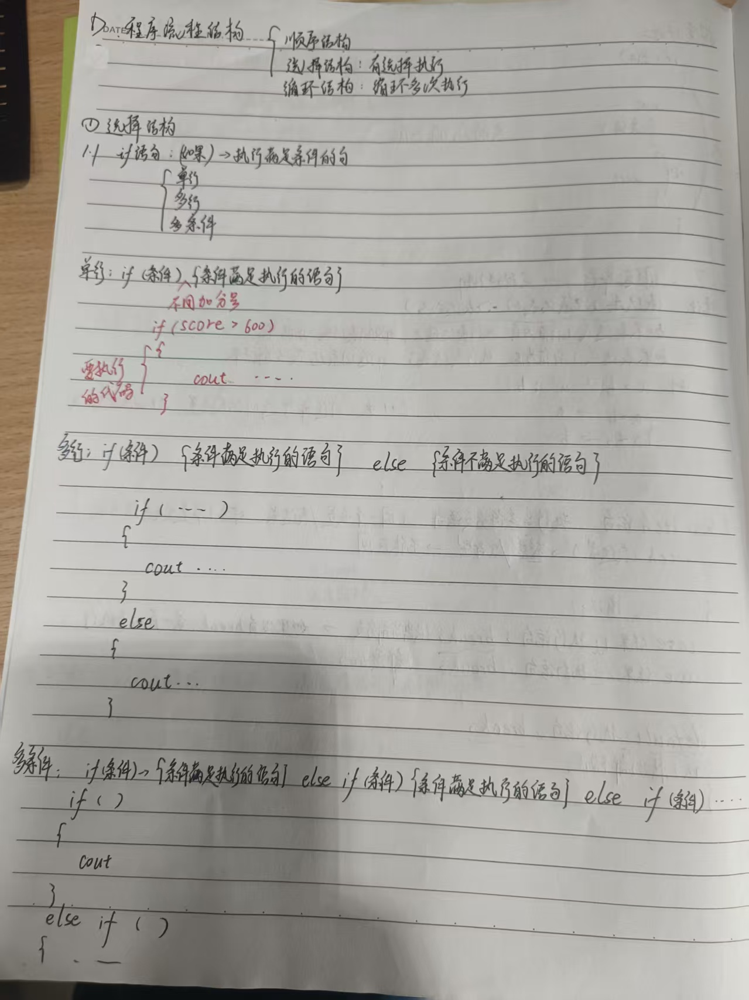

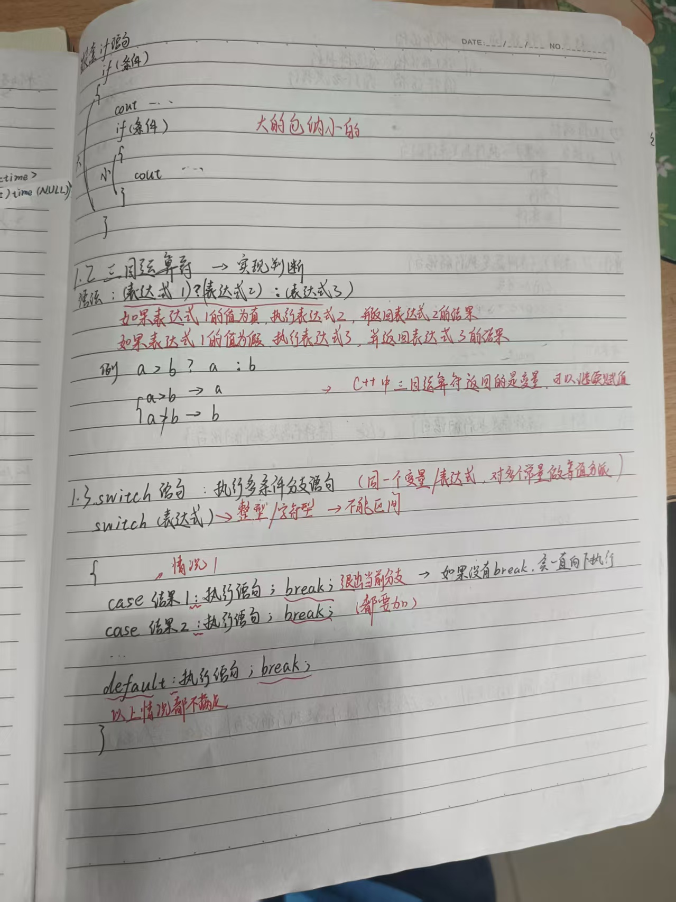

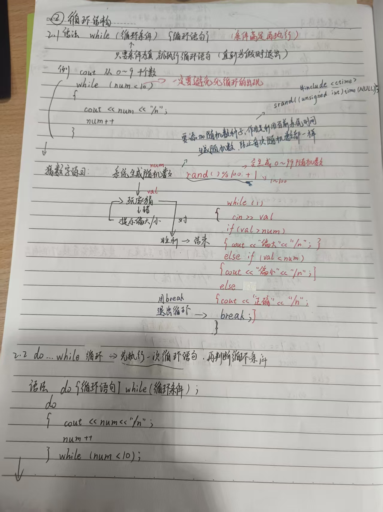

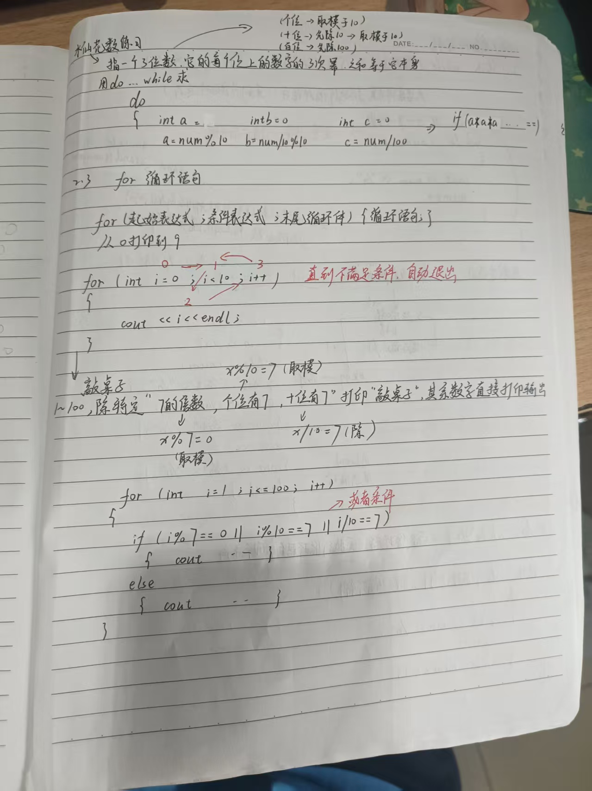

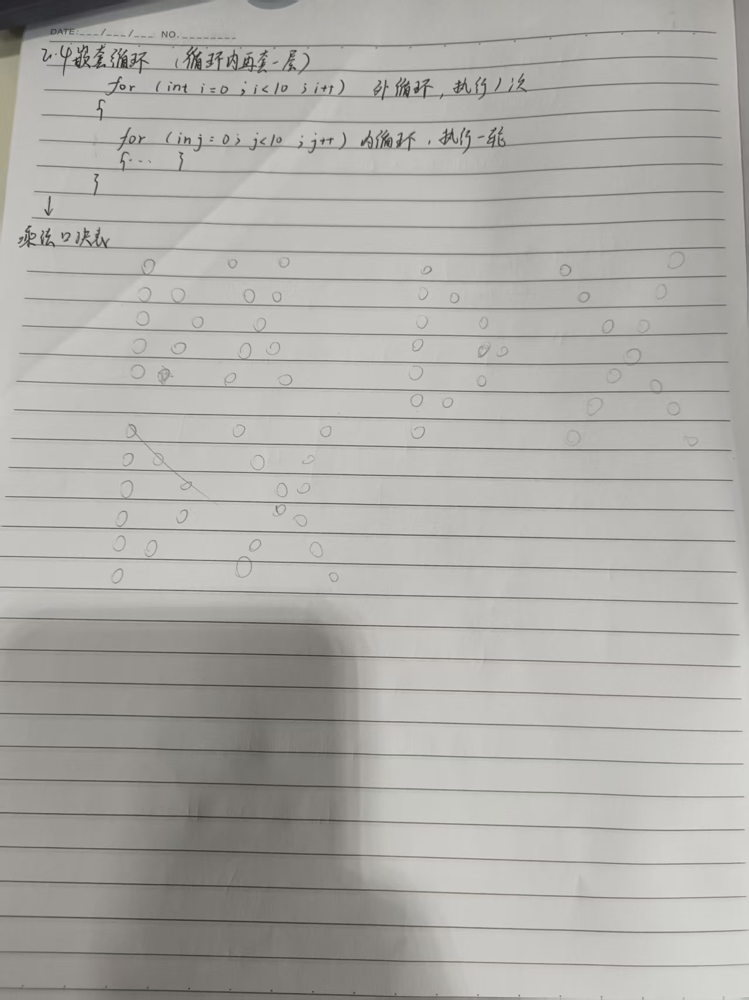

## 6. Summary

学到的三件事：

1. 命令行操作的核心是"当前目录 + 相对路径"，`pwd` 应该成为习惯；
2. Shell 脚本本质是把命令按顺序写进文本文件，重定向 `>` 让输出可以落盘；
3. Git 的 fork + PR 是参与开源协作的标准方式，PR 的修改会随分支提交自动更新。

遇到的问题及解决：

- Vim 显示 `[New DIRECTORY]`：当前目录不对或目录不存在，`cd` 到正确目录后重新打开即可；
- 粘贴无反应：Git Bash 里要用 Shift+Insert，且必须先按 `i` 进入插入模式；
- `:wq` 没反应：中文输入法把冒号变成全角，切换英文输入法后解决。

## Further Reading

- [MIT Missing Semester 中文站](https://missing-semester-cn.github.io/)
- [GitHub Git 文档](https://docs.github.com/en/get-started/using-git)
